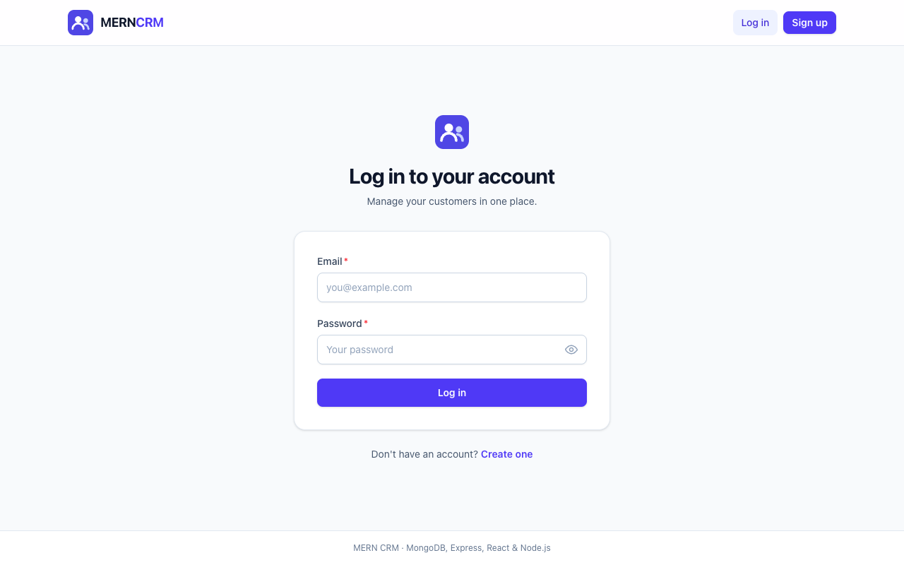
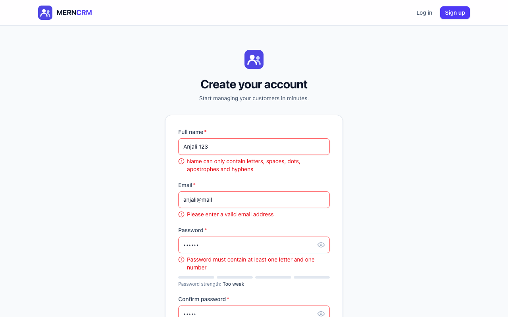
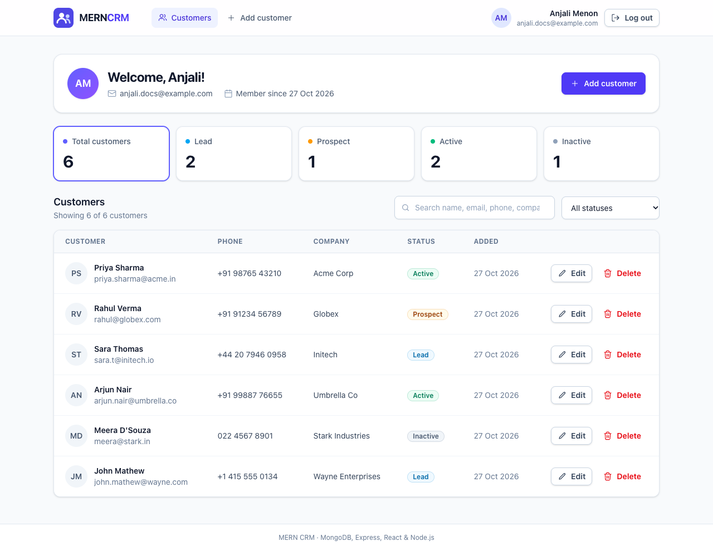
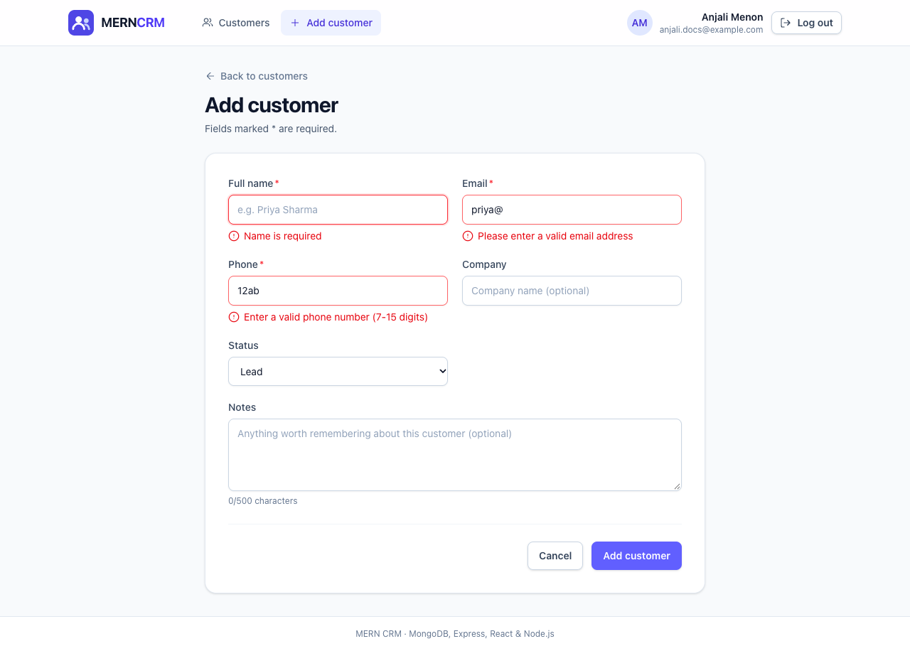
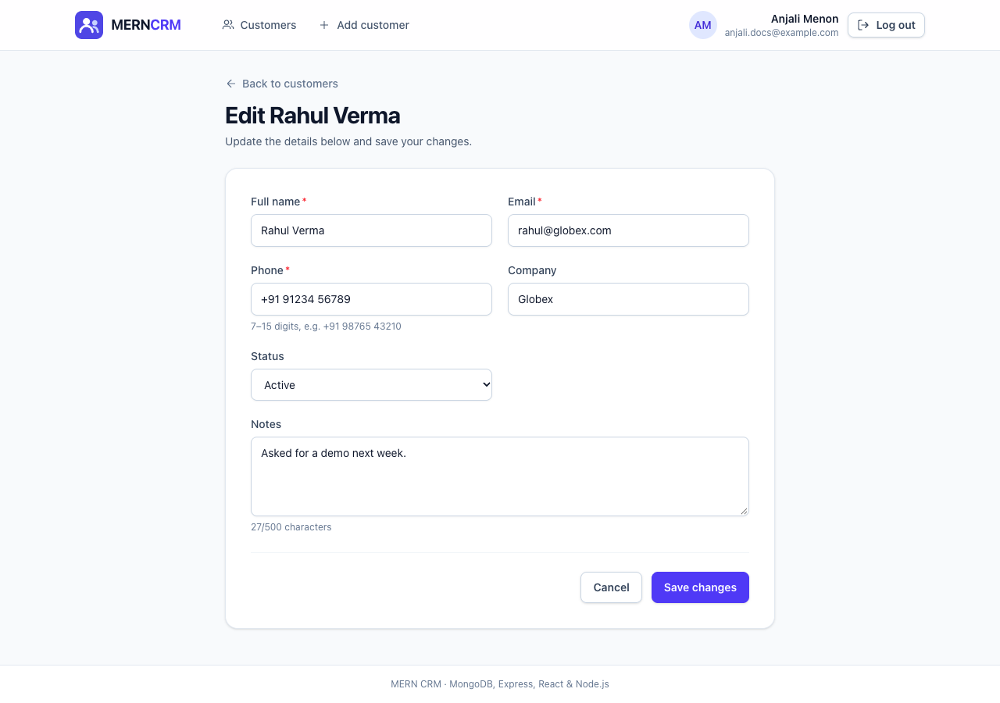
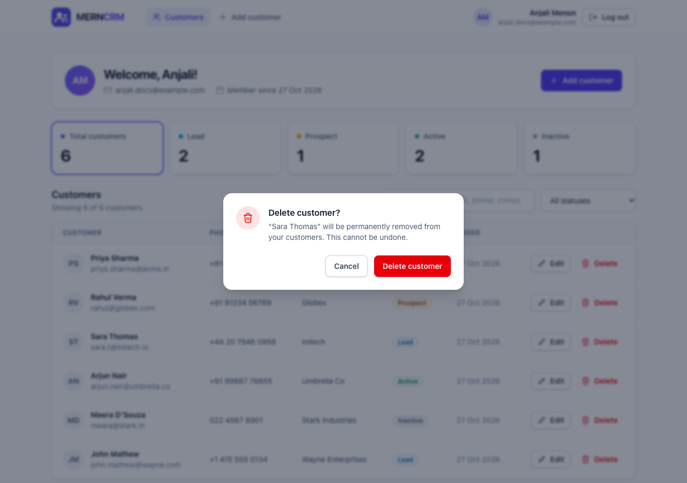
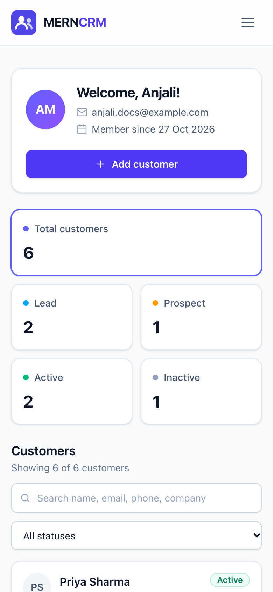
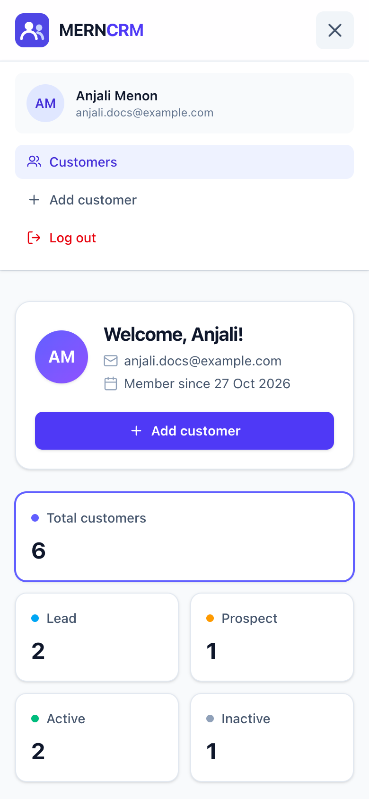

# MERN CRM — Customer Relationship Management

A full-stack **Customer Relationship Management (CRM)** application built with the **MERN stack**
(MongoDB, Express.js, React.js and Node.js) for *Full Stack Development V8 — Assignment 14 "MERN Integration"*.

Users register and log in (passwords hashed with **bcryptjs**, sessions secured with a **JWT**), then
add, view, search, update and delete their own customers. The React front end is styled with
**Tailwind CSS**, works on phones, tablets and desktops, and validates every form before calling the API.
The Express back end validates every request again in middleware and answers errors with proper HTTP
status codes and messages. All API endpoints are tested with a **Postman** collection.

> **Demo video:** [`demo/mern-crm-demo.mp4`](demo/mern-crm-demo.mp4) (about 6 minutes) — a screen recording of the complete
> functionality (register, login, user data, add / edit / delete customers, validation errors, logout,
> responsive layout, MongoDB data and the Postman test run).

---

## Table of contents

1. [Features](#features)
2. [Tech stack](#tech-stack)
3. [Folder structure](#folder-structure)
4. [Getting started](#getting-started)
5. [Environment variables](#environment-variables)
6. [API reference](#api-reference)
7. [Validation and error handling](#validation-and-error-handling)
8. [Front end](#front-end)
9. [Testing with Postman](#testing-with-postman)
10. [Screenshots](#screenshots)
11. [Assignment checklist](#assignment-checklist)

---

## Features

**Authentication**
- Register with name, email and password — the password is hashed with **bcryptjs** (10 salt rounds) by a
  Mongoose pre-save hook and is never returned by the API.
- Login returns a **JSON Web Token** (`jsonwebtoken`, expires after `JWT_EXPIRES_IN`).
- `GET /api/users/profile` returns the logged-in user's data; protected routes check the `Authorization: Bearer <token>` header.
- The React app stores the token, attaches it to every request with an axios interceptor, restores the
  session on reload and logs the user out automatically when the token expires.

**Customer data (CRUD)**
- Add, fetch all, fetch one, update and delete customers (name, email, phone, company, status, notes).
- Every customer belongs to the user who created it — users can only see and change their own customers.
- Search (name, email, phone, company) and filter by status (`Lead`, `Prospect`, `Active`, `Inactive`).
- Dashboard with the user's profile, customer statistics, a responsive table / card list and a delete confirmation dialog.

**Validation and errors**
- React forms validate on blur, while typing and on submit, and show API errors next to the right field.
- Express validation middleware rejects bad requests with `400` and a per-field `errors` object.
- A central error handler returns consistent JSON with the right status code (`400`, `401`, `404`, `409`, `413`, `415`, `500`).

---

## Tech stack

| Layer      | Technology |
| ---------- | ---------- |
| Database   | MongoDB, **Mongoose** (schemas, validation, indexes) |
| Back end   | **Node.js**, **Express.js** 5, `cors`, `dotenv`, **bcryptjs**, **jsonwebtoken**, `nodemon` (dev) |
| Front end  | **React** 19 (created with **Vite**), **react-router-dom**, **axios**, **Tailwind CSS** v4 (`@tailwindcss/vite`) |
| Testing    | **Postman** collection + environment, run headless with **newman** |
| Tooling    | ESLint, `concurrently` (run client + server together), Git + GitHub |

---

## Folder structure

The project follows the recommended structure from the assignment, with a few extra files that keep the
code modular (customer model / controller / routes, validation and error middleware, API services, reusable components).

```
mern-crm/
├── client/                         # React front end (Vite + Tailwind CSS)
│   ├── public/
│   │   └── favicon.svg
│   ├── index.html
│   ├── vite.config.js              # React + Tailwind plugins, dev server on port 5174
│   └── src/
│       ├── api/axios.js            # axios instance: base URL, JWT interceptor, 401 handling
│       ├── components/             # reusable UI: Navbar, CustomerForm, CustomerList, ConfirmDialog,
│       │                           #   FormField, Button, Alert, StatsCards, ProfileCard, ...
│       ├── context/                # AuthContext + AuthProvider (token, user, login/register/logout)
│       ├── hooks/                  # useAuth, useForm (form state + validation), useDocumentTitle
│       ├── pages/
│       │   ├── Register.jsx
│       │   ├── Login.jsx
│       │   ├── Userdata.jsx        # user data + customer list (search, filter, edit, delete)
│       │   ├── AddCustomer.jsx
│       │   ├── EditCustomer.jsx
│       │   └── NotFound.jsx
│       ├── routes/                 # AppRoutes, ProtectedRoute, GuestRoute
│       ├── services/               # authService, customerService (API calls)
│       ├── utils/                  # validation rules, error helpers, formatting, constants
│       ├── App.jsx
│       ├── index.css               # @import "tailwindcss"
│       └── index.jsx               # entry point
│
├── server/                         # Node.js / Express back end
│   ├── config/db.js                # MongoDB connection with Mongoose
│   ├── controllers/
│   │   ├── UserController.js       # register, login, profile
│   │   └── CustomerController.js   # customer CRUD
│   ├── middleware/
│   │   ├── Auth.js                 # JWT "protect" middleware
│   │   ├── Validate.js             # request validation middleware
│   │   ├── ErrorHandler.js         # 404 + central error handler
│   │   └── Logger.js               # request logger
│   ├── models/
│   │   ├── UserModel.js            # User schema (bcrypt pre-save hook)
│   │   └── CustomerModel.js        # Customer (CRM) schema
│   ├── routes/
│   │   ├── UserRoutes.js           # /api/users
│   │   └── CustomerRoutes.js       # /api/customers
│   ├── utils/                      # ApiError, generateToken, shared validators
│   └── app.js                      # Express app + server start
│
├── postman/                        # Postman collection, environment and newman results
├── demo/                           # demo video
├── docs/screenshots/               # screenshots used in this README
├── .env.example                    # copy to .env (the real .env is not committed)
├── package.json                    # root scripts: install:all, dev, server, client, test:api
└── README.md
```

---

## Getting started

### Prerequisites

- **Node.js 22.12+** and npm (the server alone runs on Node 20.19+, but the root `npm run dev` script uses `concurrently`, which needs Node 22)
- **MongoDB** — a local server, a Docker container or a free MongoDB Atlas cluster
- (optional) **Postman** to run the API collection

### 1. Clone and install

```bash
git clone <repository-url> mern-crm
cd mern-crm
npm run install:all        # installs root, server and client dependencies
```

<details>
<summary>Or install each part the way the assignment describes</summary>

```bash
# back end
cd server
npm i express dotenv cors mongoose bcryptjs jsonwebtoken
npm i -D nodemon

# front end
cd ../client
npm install tailwindcss @tailwindcss/vite
npm i axios react-router-dom
```
</details>

### 2. Configure the environment

```bash
cp .env.example .env
```

Edit `.env` and set at least `MONGO_URI` and a long random `JWT_SECRET`
(see [Environment variables](#environment-variables)). Need a MongoDB quickly? With Docker:

```bash
docker run -d --name mern-crm-mongo -p 27017:27017 mongo:7
```

### 3. Run the app

```bash
npm run dev                # starts the API and the React app together
```

Or run them in two terminals, exactly as in the assignment:

```bash
cd server && npm run dev   # API  -> http://localhost:5014/api   (nodemon)
cd client && npm start     # React -> http://localhost:5174       (Vite)
```

Open **http://localhost:5174**, create an account and start adding customers.

| Script (root)          | What it does |
| ---------------------- | ------------ |
| `npm run install:all`  | install root, server and client dependencies |
| `npm run dev`          | run server (nodemon) and client (Vite) together with `concurrently` |
| `npm run server`       | run only the API (`server/ → npm run dev`) |
| `npm run client`       | run only the React app (`client/ → npm start`) |
| `npm run build`        | production build of the React app (`client/dist`) |
| `npm run test:api`     | run the Postman collection with newman (API must be running) |

---

## Environment variables

All variables live in **one `.env` file in the project root**. The server loads it with `dotenv`; Vite reads
the same file but only exposes variables that start with `VITE_` to the browser, so secrets stay on the server.

| Variable         | Example                              | Used by | Description |
| ---------------- | ------------------------------------ | ------- | ----------- |
| `PORT`           | `5014`                               | server  | Port of the Express API |
| `MONGO_URI`      | `mongodb://127.0.0.1:27017/mern_crm` | server  | MongoDB connection string (local or Atlas) |
| `JWT_SECRET`     | *long random string*                 | server  | Secret used to sign and verify JWTs |
| `JWT_EXPIRES_IN` | `1d`                                 | server  | Token lifetime |
| `CLIENT_URL`     | `http://localhost:5174`              | server  | Allowed CORS origin(s), comma separated |
| `VITE_API_URL`   | `http://localhost:5014/api`          | client  | Base URL the React app calls |

Generate a secret with `node -e "console.log(require('crypto').randomBytes(48).toString('hex'))"`.

---

## API reference

Base URL: `http://localhost:5014/api`. All request and response bodies are JSON.
Protected endpoints need the header `Authorization: Bearer <token>`.

### Users (authentication)

| Method | Endpoint          | Access    | Body                          | Success |
| ------ | ----------------- | --------- | ----------------------------- | ------- |
| POST   | `/users/register` | Public    | `{ name, email, password }`   | `201` `{ success, message, token, user }` |
| POST   | `/users/login`    | Public    | `{ email, password }`         | `200` `{ success, message, token, user }` |
| GET    | `/users/profile`  | Protected | —                             | `200` `{ success, user }` |

### Customers (CRM data) — all protected

| Method | Endpoint          | Body / query                                              | Success |
| ------ | ----------------- | --------------------------------------------------------- | ------- |
| GET    | `/customers`      | optional `?search=text&status=Lead\|Prospect\|Active\|Inactive` | `200` `{ success, count, customers }` |
| POST   | `/customers`      | `{ name, email, phone, company?, status?, notes? }`       | `201` `{ success, message, customer }` |
| GET    | `/customers/:id`  | —                                                         | `200` `{ success, customer }` |
| PUT    | `/customers/:id`  | any of `{ name, email, phone, company, status, notes }`   | `200` `{ success, message, customer }` |
| DELETE | `/customers/:id`  | —                                                         | `200` `{ success, message, customer: { _id } }` |
| GET    | `/health`         | public health check (API + database status)               | `200` |

### Data models

**User** — `name` (2–50 chars), `email` (unique, lowercase, valid format), `password` (bcrypt hash, `select: false`), timestamps.

**Customer** — `name` (2–60), `email` (valid, unique per user), `phone` (7–15 digits), `company` (≤ 100),
`status` (`Lead` default, `Prospect`, `Active`, `Inactive`), `notes` (≤ 500), `user` (owner, ref `User`), timestamps.

### Example

```http
POST /api/users/login
Content-Type: application/json

{ "email": "anjali.menon@example.com", "password": "Crm@2026" }
```

```json
{
  "success": true,
  "message": "Login successful",
  "token": "eyJhbGciOiJIUzI1NiIsInR5cCI6IkpXVCJ9...",
  "user": { "_id": "...", "name": "Anjali Menon", "email": "anjali.menon@example.com", "createdAt": "...", "updatedAt": "..." }
}
```

---

## Validation and error handling

**Request validation middleware** (`server/middleware/Validate.js`) runs before the controllers:
it trims text (never passwords), lowercases emails, checks required fields, types, lengths, formats
(email, phone, name characters in any language, password strength), allowed statuses, ObjectId format and
query parameters, and rejects bodies that are not JSON (or form-encoded) with `415`.

**Central error handler** (`server/middleware/ErrorHandler.js`) turns every error into the same JSON shape:

```json
{ "success": false, "message": "Validation failed", "errors": { "email": "Please provide a valid email address" } }
```

| Status | When |
| ------ | ---- |
| `400`  | validation failed, malformed JSON, invalid customer id, invalid query |
| `401`  | missing / invalid / expired token, wrong email or password |
| `404`  | customer not found (or owned by another user), unknown route |
| `409`  | email already registered, or customer email already used by this user |
| `413`  | request body larger than 10 kB |
| `415`  | body sent with an unsupported content type (e.g. `text/plain`) |
| `500`  | unexpected server error — the client gets `Internal server error`, details stay in the server log |

---

## Front end

| Route                  | Page              | Access    |
| ---------------------- | ----------------- | --------- |
| `/register`            | `Register.jsx`    | guests only |
| `/login`               | `Login.jsx`       | guests only |
| `/customers`           | `Userdata.jsx` — user data, statistics, search / filter, customer list | logged in |
| `/customers/new`       | `AddCustomer.jsx` | logged in |
| `/customers/:id/edit`  | `EditCustomer.jsx`| logged in |
| `*`                    | `NotFound.jsx`    | everyone |

- **Routing:** `ProtectedRoute` sends logged-out users to `/login` (and back to the page they wanted after
  logging in); `GuestRoute` keeps logged-in users away from the login and register pages.
- **API integration:** `src/api/axios.js` + `src/services/*` — the JWT is attached automatically, a `401`
  clears the session, and logging in or out in one browser tab updates the other open tabs.
- **Validation:** `src/utils/validation.js` mirrors the server rules; `useForm` validates on blur, while typing
  and on submit, focuses the first invalid field and maps API field errors (e.g. `409` duplicate email) to the inputs.
- **Responsive UI:** Tailwind CSS utility classes — a table on tablets and desktops (less important columns
  appear on wider screens), cards on phones, a collapsible navigation menu, single-column forms on small screens,
  loading spinners, empty states, a keyboard-friendly delete dialog and accessible labels / focus styles.

---

## Testing with Postman

The `postman/` folder contains:

| File | Description |
| ---- | ----------- |
| `MERN-CRM.postman_collection.json` | 83 requests with 524 assertions, grouped in folders: Health, Auth, Customers CRUD, Validation & Errors, Security & Misc |
| `MERN-CRM.postman_environment.json` | `baseUrl = http://localhost:5014/api` |
| `newman-run.txt` | output of the last full run |
| `newman-report.html` | HTML report of the last full run (open in a browser) |

**In Postman:** *Import* both JSON files, select the **MERN CRM - Local** environment and run the collection
(*Run collection*). The requests chain automatically: register / login store the token, created customer ids
are saved and reused, and the last requests clean up the test customers.

**From the terminal** (API running; newman is downloaded with `npx` the first time):

```bash
npm run test:api
```

Last run: **83 requests, 524 assertions, 0 failures** (see `postman/newman-run.txt`).

The suite checks success responses **and** error cases: missing / invalid fields (`400`), duplicate emails
(`409`), wrong password and missing / forged / unsigned tokens (`401`), another user's customer (`404`),
malformed ids, unknown routes, malformed JSON, oversized bodies (`413`) and non-JSON bodies (`415`).

---

## Screenshots

| Login | Register (validation) |
| ----- | --------------------- |
|  |  |

| Customer data (desktop) | Add customer (validation) |
| ----------------------- | ------------------------- |
|  |  |

| Edit customer | Delete confirmation |
| ------------- | ------------------- |
|  |  |

| Mobile — customers | Mobile — menu |
| ------------------ | ------------- |
|  |  |

---

## Assignment checklist

| Requirement (rubric) | Where to find it |
| -------------------- | ---------------- |
| CRUD + authentication in the back end (password hashing, token generation) | `server/controllers/*`, `server/models/UserModel.js` (bcrypt hook), `server/utils/generateToken.js`, `server/middleware/Auth.js` |
| Database connectivity and schemas | `server/config/db.js`, `server/models/UserModel.js`, `server/models/CustomerModel.js` |
| Validation middleware and error handling | `server/middleware/Validate.js`, `server/middleware/ErrorHandler.js`, `server/utils/ApiError.js` |
| Modular back end (routes, controllers, middleware) | `server/routes`, `server/controllers`, `server/middleware`, `server/config`, `server/models` |
| Front-end folder structure (components, pages, routes) | `client/src/components`, `client/src/pages`, `client/src/routes` |
| Tailwind CSS responsive UI | `client/vite.config.js` (`@tailwindcss/vite`), `client/src/index.css`, all components |
| Register, login and customer forms in React | `client/src/pages/Register.jsx`, `Login.jsx`, `Userdata.jsx`, `components/CustomerForm.jsx` |
| Front-end validation | `client/src/utils/validation.js`, `client/src/hooks/useForm.js`, `components/FormField.jsx` |
| API tested with Postman | `postman/` |
| Video of the working application | `demo/mern-crm-demo.mp4` |
| Git + GitHub with commits and README | commit history of this repository, this README |
